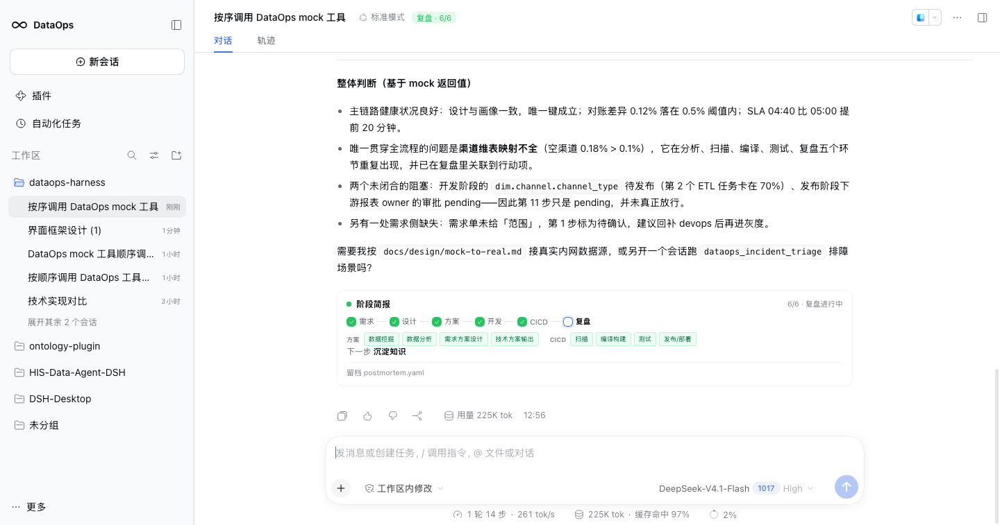

# DataOps Harness

## 获取代码

```sh
git clone --recurse-submodules git@github.com:YunSheng-T/dataops-harness.git
# 或者克隆后：
git submodule update --init --recursive
```

基于 [DeepSeek Harness](https://github.com/deepseek-ai/deepseek-harness)（DSH）的数据开发工作台。
**独立项目，与 DeepSeek 不存在隶属、合作、授权或背书关系。**

## 安装 DSH（前置）

DataOps bundle **不包含 DSH runtime**。仓库里的 `deepseek-harness/` submodule 和 `upstream.json` 是源码引用/版本 pin，不是可直接执行的 runtime。

先选择一种安装方式：

### A. 全局 npm（推荐固定版本）

```bash
npm install -g @deepseek-ai/dsh@0.2.1-rc.4
dsh --version
```

### B. DSH Desktop 自带 runtime

DSH Desktop 不一定把 `dsh` 放到全局 PATH。可以使用它自带的终端，或：

```bash
./scripts/dsh --version
```

当前 `scripts/dsh` 优先找 DSH Desktop；如果桌面端不在默认路径，用 `DSH_APP_PATH` 指向它的 `Contents/Resources/app`。如果机器上还有 DSH NEXT，请安装对应的全局 CLI，避免实际 runtime 和 pin 不一致。

### C. 内网已有 DSH runtime

使用内网提供的兼容版本，并显式指定：

```bash
/path/to/dsh --version
DSH_BIN=/path/to/dsh node scripts/check-runtime-version.mjs
```

兼容范围：

```text
>=0.2.1-rc.2 <0.3.0
```

推荐统一到 `upstream.json` 的 pin `0.2.1-rc.4`。

## 当前运行时

仓库 pin 写在 `upstream.json`：

```text
runtimeVersion: 0.2.1-rc.4
compatibleRuntimeRange: >=0.2.1-rc.2 <0.3.0
```

启动前先检查：

```bash
node scripts/check-runtime-version.mjs
```

当前机器如果实际运行 rc.2，会明确告警；不要把 rc.2 的验证结果标成 rc.4。内网安装必须使用兼容的 DSH runtime，并优先统一到 pin 版本。

## 里面有什么

| 目录 | 内容 |
|---|---|
| `packages/dataops-client` | 用户面插件：15 类 toolview（事实/CICD/USPicker/阶段卡/StageResultCard 等）、标题阶段 chip、阶段简报、右栏资产/血缘/证据、会话内 LineageGraph |
| `packages/dataops-brand` | 品牌插件：∞ 标记 + `DataOps` 字标（侧栏 + 空会话 Hero） |
| `packages/dataops-tools` | Host 工具：22 个活动工具（30 个已实现注册）；事实/CICD/工作项/日志/presenter/US/DataMap/ensure/stage/ltsgen；provider 支持 `mock` / `cli` / `http` |
| `packages/dataops-preset` | Agent preset `dataops-dev` 的 patch 源片段：DataOps Lead persona、workflow/workitem 技能、文件/提问/待办工具、发布审批约束 |
| `packages/dataops-bundle` | 发布 bundle：组合 tools/brand/client/preset，声明 `dsh.bundle` 与 `engines.dsh`；用户唯一安装入口 |
| `packages/dataops-install` | 安装 / 诊断 / 卸载 CLI：preflight、seed web 模板、官方 `dsh plugin add`、receipt、skills、离线 overrides |
| `profiles/dataops` | 独立 profile 模板（基于 `dsh-base` + `dsh-web-app`，不碰 `desktop` profile） |
| `.agents/skills` | 领域技能：SQL 评审、建模评审、管道排障、影响面、服务契约、工作项协议、阶段技能、ltsgen |
| `prototype` | 原生 DSH 界面追加原型、三视图富节点血缘图谱原型（React Flow）与截图 |
| `docs/design` | 框架、用户面、换品牌、发布/安装、Mock 演示、真实数据接入、内网 provider 契约 |
| `workitems/_template` | 工作项 v0 模板：item.yaml / intent.md / plan.md / decision.md；交付阶段与审批记录 |
| `docs/ops` | 内网安装、升级、Agent playbook、离线 provider 示例 |

> **阶段模型 v2**：本版实现到 Stage 5（需求 → 设计 → 方案 → 开发 → CICD）；Stage 6 不实现。阶段/设计归属与公共组件视图见 [docs/design/blueprint-v2.md](docs/design/blueprint-v2.md) 和 [prototype/blueprint-v2.html](prototype/blueprint-v2.html)。

用户入口、Agent 编排、工作项与工具边界见 [docs/design/agent-orchestration.md](docs/design/agent-orchestration.md)。真实系统接入边界见 [docs/design/intranet-architecture.md](docs/design/intranet-architecture.md)。

设计文档索引：[docs/design/README.md](docs/design/README.md) · 用户旅程：[docs/design/user-journey/README.md](docs/design/user-journey/README.md) · US 接单+需求：[docs/design/user-journey/stage-0-1-us-intake-requirement.md](docs/design/user-journey/stage-0-1-us-intake-requirement.md) · 遗留事项：[docs/backlog.md](docs/backlog.md) · P1 总结：[docs/design/p1-summary.md](docs/design/p1-summary.md) · P2 计划：[docs/design/p2-plan.md](docs/design/p2-plan.md) · P2 设计：[docs/design/p2-tool-convergence.md](docs/design/p2-tool-convergence.md)。

P2 可视化：[全量蓝图](prototype/p2-tool-convergence-blueprint.html) · [P1 → P2 增量](prototype/p2-tool-convergence-blueprint-delta.html)。

P3 可视化：[0+1 → Stage 3 蓝图](prototype/stage0-3-implementation-blueprint.html) · [增量](prototype/stage0-3-implementation-blueprint-delta.html) · [Agent/Skill 设计](docs/design/user-journey/agent-skill-design.md) · [实现状态](docs/design/user-journey/implementation-status.md) · [ADR 0006](docs/decisions/0006-stage-runtime.md) · [ADR 0007](docs/decisions/0007-current-gate-dock.md) · [通宵报告](docs/design/user-journey/overnight-report.md)。

发布/安装：[设计](docs/design/release-install.md) · [全量蓝图](prototype/release-install-blueprint.html) · [增量](prototype/release-install-blueprint-delta.html) · [ADR 0013](docs/decisions/0013-release-install-unit.md)。

P0-B Repo Doctor：[全量蓝图](prototype/dataops-repo-doctor-blueprint.html) · [增量](prototype/dataops-repo-doctor-blueprint-delta.html) · [设计](docs/design/repo-doctor.md)。

P2.1 Code Scan Integration：[Mock 全量](prototype/code-scan-integration-blueprint.html) · [Mock 增量](prototype/code-scan-integration-blueprint-delta.html) · [设计](docs/design/code-scan-integration.md)。

DataOps Dev P2 Agent 共同编辑：[设计](docs/design/dataops-dev-agent-collaboration.md) · [ADR 0015](docs/decisions/0015-dataops-dev-agent-collaboration.md) · [全量蓝图](prototype/dataops-dev-agent-collaboration-blueprint.html) · [P1 → P2 增量](prototype/dataops-dev-agent-collaboration-blueprint-delta.html)。

DataOps Dev P3 结构化源码与 Diagnostics（已验收）：[设计](docs/design/dataops-dev-structured-diagnostics.md) · [ADR 0016](docs/decisions/0016-dataops-dev-structured-diagnostics.md) · [全量蓝图](prototype/dataops-dev-structured-diagnostics-blueprint.html) · [P2 → P3 增量](prototype/dataops-dev-structured-diagnostics-blueprint-delta.html) · [验证报告](docs/dataops-dev/verification/P3验证报告.md)。

DataOps Dev P4 Artifact 动作与 Slots（已验收）：[设计](docs/design/dataops-dev-artifact-actions-slots.md) · [ADR 0017](docs/decisions/0017-dataops-dev-artifact-actions-slots.md) · [全量蓝图](prototype/dataops-dev-artifact-actions-slots-blueprint.html) · [P3 → P4 增量](prototype/dataops-dev-artifact-actions-slots-blueprint-delta.html) · [验证报告](docs/dataops-dev/verification/P4验证报告.md)。

DataOps Dev P5 已保存作业 DryRun（DR-01～07 安全发起、异步结果、恢复与完整安全矩阵已通过；DR-08 真实平台验收阻塞，完整 P5 未验收）：[设计](docs/design/dataops-dev-dryrun.md) · [ADR 0018](docs/decisions/0018-dataops-dev-dryrun.md) · [全量蓝图](prototype/dataops-dev-dryrun-blueprint.html) · [P4 → P5 增量](prototype/dataops-dev-dryrun-blueprint-delta.html) · [交互原型](prototype/dataops-dev-dryrun-prototype.html) · [验证报告](docs/dataops-dev/verification/P5验证报告.md)。

验收清单：[P1 + P2 验收](docs/verification/p1-p2-acceptance.md)。

可视化：[Agent 架构全量蓝图](prototype/agent-architecture.html) · [v2 → Agent v1 增量](prototype/agent-architecture-delta.html)。

## 当前能力

```text
US 接单 → 需求 → 设计 → 3a/3b/3c → 开发 → CICD
Artifact Ledger：不可变 revision + currentIteration + evidenceRefs
DataOps 右栏：仓库体检 / 资产 / 血缘 / 交付物 / 证据 / 检查
Lineage：table_lineage / data_flow / task_dag；task_dag 来自真实 task.yaml
CICD：mock pipeline + 制品包；deploy=opt-in；真实部署仅 internal 配置
ltsgen：mock 生成 lts_code/<task>/task.yaml + output/<package>.zip；jar 内网替换
```

## Mock 演示

不接内网，按阶段流转脚本走：

- [阶段流转演示脚本](docs/demo/stage-flow-demo-2026-11-03.md)
- [功能演示脚本](docs/demo/2026-11-03-demo-script.md)
- [Mock 演示设计](docs/design/mock-demo.md)

演示工作项可用 US 接单创建，也可用 seed 兜底。重复演示先归档旧 Workitem：

```bash
node scripts/reset-dataops-demo.mjs --id <workitem-id>
```



## 快速开始

### 1. 构建

```bash
node packages/dataops-client/scripts/build.mjs
node packages/dataops-brand/scripts/build.mjs
node scripts/verify-local.mjs
```

`verify-local` 通过后才启动。

### 2. 选择安装方式

开发机 source-link：

```bash
node scripts/install-dataops-profile.mjs
node scripts/install-dataops-skills.mjs
node scripts/check-install.mjs --home "$DSH_HOME"
dsh --profile dataops
```

内网稳定机 release：

```bash
node scripts/release-dataops.mjs
node packages/dataops-install/bin/dataops-install.mjs install \
  --dsh <path-to-dsh> \
  --offline dist/dataops-0.1.0 \
  --yes
node packages/dataops-install/bin/dataops-install.mjs doctor --dsh <path-to-dsh>
```

升级见 [内网升级手册](docs/ops/update-dataops-on-intranet.md)。
安装/升级前不要使用会丢掉用户插件的 `--reset`。

### 3. 检查 runtime

```bash
node scripts/check-runtime-version.mjs
```

当前 pin 是 rc.4；如果实际是 rc.2，只能视为兼容运行，不能当作 rc.4 验收。

### 4. 启动

```bash
DSH_HOME="$DSH_HOME" dsh --profile dataops
```

没有全局 `dsh` 时：

```bash
./scripts/dsh --profile dataops
```

桌面端自带的终端也可以直接运行 `dsh --profile dataops`。

## 本地发布与安装（M2/M3）

```sh
# 构建 registry-free 发布目录：dist/dataops-0.1.0
node scripts/release-dataops.mjs

# 用安装器装到独立 dataops profile（不碰 desktop）
node packages/dataops-install/bin/dataops-install.mjs install \
  --dsh ./scripts/dsh \
  --offline dist/dataops-0.1.0 \
  --yes

# 诊断 / 卸载
node packages/dataops-install/bin/dataops-install.mjs doctor --dsh ./scripts/dsh
node packages/dataops-install/bin/dataops-install.mjs uninstall --dsh ./scripts/dsh --yes
```

本地发布只做 tarball + manifest + sha256 + notices；内部 registry 发布/ACL 留到内网 M3 gate。若工作树被其他在研改动阻塞，先跑 `node scripts/verify-local.mjs` 定位；`--skip-checks` 只用于本地打包，不作为发布门禁。

headless 验收记录见 [docs/verification/release-install-acceptance.md](docs/verification/release-install-acceptance.md)；用户操作见 [docs/ops/release-install.md](docs/ops/release-install.md)。

## 验证

```bash
node scripts/verify-local.mjs                 # 16 项离线检查
node packages/dataops-tools/scripts/check.mjs # 30 个已实现工具；22 个活动面
node packages/dataops-client/scripts/check.mjs
node scripts/check-runtime-version.mjs
```

真机验证记录见 [docs/design/rebranding.md](docs/design/rebranding.md)。

## 设计原则

- **不 fork**：锁上游版本，领域能力用插件/技能/预设叠加。
- **只加不改**：不新增侧栏、不改对话头、不加输入框；禁用插件后界面应与原版一致。
- **产物优先**：卡片是产物的视图，结论必须带证据。
- **品牌只换名字/Logo**：主题 token、`@deepseek-ai/*` 包名、`dsh` 命令、`DSH_*` 环境变量都不动。

- [Stage 4–5 实现蓝图](prototype/stage-4-5-blueprint.html)

- [架构治理清单](docs/design/architecture-governance.md)

- [架构文档索引](docs/design/architecture-index.md)

- [内网 Stage 0–5 实施计划](docs/plans/intranet-stage0-5.md)

- [内网离线安装](docs/ops/offline-install.md)

- [内网升级手册](docs/ops/update-dataops-on-intranet.md)

- [内网 Agent playbook](docs/ops/intranet-agent-playbook.md)

- [内网 provider 契约](docs/design/internal-integration-contract.md)

- [交接包评估](docs/design/handoff-20261102-assessment.md)

## 本地验收

```sh
node scripts/verify-local.mjs
```

无网络、无浏览器、无真实平台。

安装后验证：

```sh
node scripts/check-install.mjs
```

- [内网 DSH 接入与 Agent 迭代](docs/ops/intranet-dsh-setup.md)
