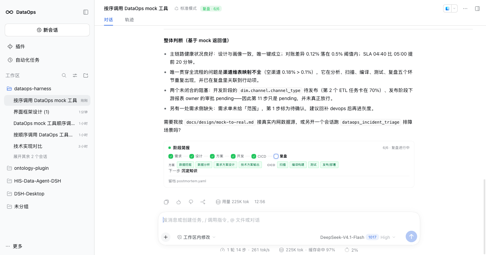

# DataOps Harness

## 获取代码

```sh
git clone --recurse-submodules git@github.com:YunSheng-T/dataops-harness.git
# 或者克隆后：
git submodule update --init --recursive
```

基于 [DeepSeek Harness](https://github.com/deepseek-ai/deepseek-harness)（DSH）的数据开发工作台。
**独立项目，与 DeepSeek 不存在隶属、合作、授权或背书关系。**

## 里面有什么

| 目录 | 内容 |
|---|---|
| `packages/dataops-client` | 用户面插件：14 个活动 toolview（事实/CICD/USPicker/阶段卡/StageResultCard 等）、标题阶段 chip、阶段简报、右栏资产/血缘/证据 |
| `packages/dataops-brand` | 品牌插件：∞ 标记 + `DataOps` 字标（侧栏 + 空会话 Hero） |
| `packages/dataops-tools` | Host 工具：19 个活动原子能力（事实/CICD/工作项/日志/presenter/US/DataMap/ensure/stage）；provider 支持 `mock` / `cli` / `http`；真实域 adapter 见内网架构 |
| `packages/dataops-preset` | Agent preset `dataops-dev`：DataOps Lead persona、workflow/workitem 技能、文件/提问/待办工具、发布审批约束 |
| `profiles/dataops` | 独立 profile 模板（基于 `dsh-base` + `dsh-web-app`，不碰 `desktop` profile） |
| `.agents/skills` | 领域技能：SQL 评审、建模评审、管道排障、影响面、服务契约、工作项协议 |
| `prototype` | 原生 DSH 界面追加原型、三视图富节点血缘图谱原型（React Flow）与截图 |
| `docs/design` | 框架、用户面、换品牌、Mock 演示、真实数据接入 |
| `workitems/_template` | 工作项 v0 模板：item.yaml / intent.md / plan.md / decision.md；交付阶段与审批记录 |
| `docs/dataops-harness-blueprint.md` | 两仓库关系与 DSH 高价值资产盘点 |

> **阶段模型 v2**：本版实现到 Stage 5（需求 → 设计 → 方案 → 开发 → CICD）；Stage 6 不实现。阶段/设计归属与公共组件视图见 [docs/design/blueprint-v2.md](docs/design/blueprint-v2.md) 和 [prototype/blueprint-v2.html](prototype/blueprint-v2.html)。

用户入口、Agent 编排、工作项与工具边界见 [docs/design/agent-orchestration.md](docs/design/agent-orchestration.md)。真实系统接入边界见 [docs/design/intranet-architecture.md](docs/design/intranet-architecture.md)。

设计文档索引：[docs/design/README.md](docs/design/README.md) · 用户旅程：[docs/design/user-journey/README.md](docs/design/user-journey/README.md) · US 接单+需求：[docs/design/user-journey/stage-0-1-us-intake-requirement.md](docs/design/user-journey/stage-0-1-us-intake-requirement.md) · 遗留事项：[docs/backlog.md](docs/backlog.md) · P1 总结：[docs/design/p1-summary.md](docs/design/p1-summary.md) · P2 计划：[docs/design/p2-plan.md](docs/design/p2-plan.md) · P2 设计：[docs/design/p2-tool-convergence.md](docs/design/p2-tool-convergence.md)。

P2 可视化：[全量蓝图](prototype/p2-tool-convergence-blueprint.html) · [P1 → P2 增量](prototype/p2-tool-convergence-blueprint-delta.html)。

P3 可视化：[0+1 → Stage 3 蓝图](prototype/stage0-3-implementation-blueprint.html) · [增量](prototype/stage0-3-implementation-blueprint-delta.html) · [Agent/Skill 设计](docs/design/user-journey/agent-skill-design.md) · [实现状态](docs/design/user-journey/implementation-status.md) · [ADR 0006](docs/decisions/0006-stage-runtime.md) · [ADR 0007](docs/decisions/0007-current-gate-dock.md) · [通宵报告](docs/design/user-journey/overnight-report.md)。

发布/安装：[设计](docs/design/release-install.md) · [全量蓝图](prototype/release-install-blueprint.html) · [增量](prototype/release-install-blueprint-delta.html) · [ADR 0013](docs/decisions/0013-release-install-unit.md)。

验收清单：[P1 + P2 验收](docs/verification/p1-p2-acceptance.md)。

可视化：[Agent 架构全量蓝图](prototype/agent-architecture.html) · [v2 → Agent v1 增量](prototype/agent-architecture-delta.html)。

## Mock 演示

不接内网，先跑 Stage 0–5 mock 演示 + 排障：见 [docs/design/mock-demo.md](docs/design/mock-demo.md)。



## 快速开始（本地 profile）

```sh
# 1. 构建两个客户端包
node packages/dataops-client/scripts/build.mjs
node packages/dataops-brand/scripts/build.mjs

# 可选：P1.4 自然语言 e2e（本地模型 + 交互式审批）
node scripts/e2e/dataops-p1.4.mjs --scenario query

# 2. 安装到独立 profile（默认 ~/.dsh/profiles/dataops，不碰 desktop）
node scripts/install-dataops-profile.mjs

# 3. 安装原生 dsh（推荐，版本对齐桌面端；只需一次）
npm install -g @deepseek-ai/dsh@0.2.1-rc.2

# 4. 先看组合，再启动
dsh --profile dataops --dump-config
dsh --profile dataops
```

没有网络或不想装全局时，用仓库内的包装脚本（调用桌面端自带的 CLI）：

```sh
./scripts/dsh --profile dataops
```

`dsh` 不在你的 PATH 里是正常的：桌面端只是内置了 CLI，没有全局安装。
也可以打开 DSH Desktop 自带的终端，那里的 `dsh` 已经在 PATH 上：

```sh
dsh --profile dataops
```

## 验证

```sh
cd packages/dataops-client && npm run check   # 9 条离线断言 + 5 类 seat 的注册 smoke
cd packages/dataops-brand && npm run check    # 品牌渲染 + 3 个 seat 的注册 smoke
cd packages/dataops-tools && npm run check    # 24 个注册工具（P3 活动面 16）+ 6 阶段 payload + HTTP/CLI stub + 注册 smoke
```

真机验证记录见 `docs/design/rebranding.md#验证记录`。

## 设计原则

- **不 fork**：锁上游版本，领域能力用插件/技能/预设叠加。
- **只加不改**：不新增侧栏、不改对话头、不加输入框；禁用插件后界面应与原版一致。
- **产物优先**：卡片是产物的视图，结论必须带证据。
- **品牌只换名字/Logo**：主题 token、`@deepseek-ai/*` 包名、`dsh` 命令、`DSH_*` 环境变量都不动。

- [Stage 4–5 实现蓝图](prototype/stage-4-5-blueprint.html)

- [架构治理清单](docs/design/architecture-governance.md)

- [架构文档索引](docs/design/architecture-index.md)

- [内网 Stage 0–5 实施计划](docs/plans/intranet-stage0-5.md)

- [内网离线安装](docs/ops/offline-install.md)

## 本地验收

```sh
node scripts/verify-local.mjs
```

无网络、无浏览器、无真实平台。

安装后验证：

```sh
node scripts/check-install.mjs
```

- [内网 DSH 接入与 Agent 迭代](docs/ops/intranet-dsh-setup.md)
