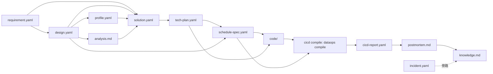

# DataOps 架构蓝图 v2

> 2026-10-25 · 阶段模型与组件边界
>
> 这张蓝图的唯一目的：回答「哪个设计属于哪个阶段」「哪些能力是公共的」「新增能力应该加在哪一层」。
> 可交互版本：`prototype/blueprint-v2.html`；Agent 入口/编排见 `agent-orchestration.md`。

---

## 0. 一句话

**阶段是工作流投影，不是插件边界。**

- 阶段负责：顺序、产物、门禁、角色。
- 组件负责：能力、契约、数据访问、渲染。
- 阶段变多不等于插件变多。公共能力只做一份，阶段只做映射和薄卡片。

---

## 1. 阶段模型

主链路 6 段，排障为旁路：

```
1 需求 → 2 设计 → 3 方案 → 4 开发 → 5 CICD → 6 复盘
                    │                 │
                    ├ 数据挖掘         ├ 扫描
                    ├ 数据分析         ├ 编译构建
                    ├ 需求方案设计     ├ 测试
                    └ 技术方案输出     └ 发布/部署

旁路：排障（incident）——不占主阶段序号
```

### 1.1 设计 = 设计产物，不是代码模块

本蓝图里的「设计」指每个阶段真正交付的设计文档/规格：

- 需求规格、数据模型、指标口径
- 挖掘/分析方案、需求实现方案、技术方案
- 代码设计、调度规格、CICD 门禁设计
- 复盘与知识

它们都落到 `workitems/<id>/artifacts/`，下游只读上游产物。

---

## 2. 阶段 × 设计产物

| 阶段 | 本阶段拥有的设计产物 | 消费的公共事实/设计 | 出口门禁 |
|---|---|---|---|
| 1 需求 | `requirement.yaml`、`intent.md` | workitem 协议、影响面、owner | 验收可验证；影响资产有 owner |
| 2 设计 | `design.yaml`、`metric-defs.yaml`、`design-review.md` | requirement、catalog/lineage、命名/分层规范 | 粒度一句话；来源可追溯；指标有 owner；模型评审通过 |
| 3 方案 | 见 3.1–3.4 | 设计产物 + 数据事实/证据 | 四步齐全；关键结论有证据；技术方案/调度规格已校验 |
| 3.1 数据挖掘 | `profile.yaml`、`eda.md` | table、lineage、evidence | 主键/空值/重复/join 覆盖有数据 |
| 3.2 数据分析 | `analysis.md` + evidence | profile、指标定义、验收标准 | 基线与验收可复核 |
| 3.3 需求方案设计 | `solution.yaml`、`solution-review.md` | requirement + design | 范围、边界、替代方案、验收映射清楚 |
| 3.4 技术方案输出 | `tech-plan.yaml`、`schedule-spec.yaml` | design/solution、平台能力目录 | 任务/依赖/SLA/平台归属齐全；spec 完整，待 CICD compile 验证 |
| 4 开发 | `code/`、`unit-tests/`、`code-review.md` | tech-plan、schedule-spec、代码规范 | 代码可运行；评审通过；本地试跑通过 |
| 5 CICD | `scan-report.yaml`、`schedule.yaml`/compile artifact、`test-report.yaml`、`release-plan.yaml`、`cicd-report.yaml` | code、schedule-spec、测试证据、审批 | compile 通过；扫描/测试/部署四门禁通过或豁免有记录 |
| 6 复盘 | `postmortem.md`、`actions.yaml`、`knowledge.md` | 全链路产物/运行数据 | 行动项有 owner/期限；知识回写 |
| 旁路 排障 | `incident.yaml`、`runbook.md` | evidence、pipeline-debug | 根因/止血/防复发可追溯 |

### 2.1 共享设计内核

这些不属于任何单一阶段，所有阶段只引用、不复制：

| 共享设计 | 内容 | 维护位置 |
|---|---|---|
| 产物协议 | artifact 结构、`as_of`、环境、`partial/gaps` | workitem 协议 + contracts |
| 证据协议 | query、time_range、env、as_of、result_digest | `dataops_shared_read_evidence` + evidence schema |
| 命名/分层/分区 | 库表命名、DWD/DWS/ADS、分区字段 | 团队规范 / AGENTS.md |
| 指标口径 | 指标定义、owner、版本 | `metric-defs.yaml`（指标库） |
| 安全与审批 | 只读默认、写操作审批、凭据 | provider + DSH credentials/interaction |
| 契约与版本 | payload kind、schema 版本、兼容性 | `packages/dataops-tools/src/contracts.js` |
| UI 规范 | 卡片、阶段条、token、空态 | `packages/dataops-client` |

### 2.2 产物依赖图



> 箭头表示「下游读取」，不表示代码依赖。人可以在任何一段改产物；下游读最新版并重新校验。

---

## 3. 阶段 → 能力 → 卡片 → 技能

| 阶段 | 工具（Host） | 卡片（Client） | 技能（Knowledge） | 备注 |
|---|---|---|---|---|
| 需求 | `dataops_requirement_extract_spec` | RequirementCard | workitem-protocol、lineage-impact | 现有能力复用 |
| 设计 | `dataops_design_compose_model`、`dataops_shared_read_table`、`dataops_shared_read_lineage` | DesignCard、TableCard、血缘工作台 | model-review、lineage-impact | 血缘工作台复用 |
| 方案·挖掘 | `dataops_shared_read_profile`（新增） | ProfileCard（新增） | data-profiling（新增） | 只读事实，带证据 |
| 方案·分析 | `dataops_shared_read_evidence`、table/lineage | EvidenceCard + 分析段落 | sql-review、sql-optimize | 不新增数据访问工具 |
| 方案·需求方案 | `dataops_design_compose_model` 复用 | SolutionCard（可从设计卡扩展） | solution-design（新增） | 不复制 design.yaml |
| 方案·挖掘/分析/需求方案 | `dataops_shared_read_profile`、`dataops_scheme_analyze_data`、`dataops_scheme_compose_solution` | Profile/Analysis/SolutionCard | data-profiling / sql-review / solution-design | 方案四步中的前三步 |
| 方案·技术方案 | `dataops_scheme_compose_tech_plan`；`schedule-yaml` SKILL 产 spec | TechPlanCard | schedule-yaml（新增） | Agent 产 spec，不在方案阶段 compile |
| 开发 | `dataops_develop_generate_code` | DevelopCard | code-review（新增） | 产出 code artifact；YAML 由 CICD compile |
| CICD | `dataops_cicd_scan`、`dataops_cicd_compile`、`dataops_cicd_test`、`dataops_cicd_release` | CicdCard + Test/Release 子卡 | cicd-gate（新增） | compile 调内部 CLI；只聚合状态/门禁 |
| 复盘 | `dataops_review_write_postmortem` | PostmortemCard | workitem-protocol | 知识回写 |
| 排障 | `dataops_incident_triage` | IncidentCard | pipeline-debug、sql-review | 旁路 |

**工具新增原则**：只有「需要新的数据访问/确定性计算」才新增工具；流程判断优先放技能，展示优先放卡片。不为每个阶段新增工具。

---

## 4. 整体组件视图

```
┌────────────────────────── DSH 运行时（不改造） ──────────────────────────┐
│ session · tool.call.toolview · header.actions · turnTail                 │
│ sidebarRightTabs · credentials · interaction/approval · workspace        │
└──────────────┬───────────────────────────────────┬───────────────────────┘
               │ slots                             │ tool calls
┌──────────────▼──────────────────┐   ┌────────────▼────────────────────────┐
│ dataops-client（UI 插件，共享）  │   │ dataops-tools（能力插件，共享）      │
│                                 │   │                                     │
│ 阶段投影                        │   │ Tool registry + contracts           │
│  brief / header / context       │   │ Capability modules                  │
│ 共享视图                        │   │  facts: table/lineage/evidence/     │
│  card kit / detail / workbench  │   │         profile                     │
│ 阶段薄卡                        │   │  design/scheme: design/tech-plan/   │
│  requirement/design/scheme/     │   │         schedule-spec               │
│  develop/cicd/review/incident   │   │  execution: develop/test/release/   │
│                                 │   │         cicd/postmortem/incident     │
│ Context/Stage store             │   │ CICD compile adapter                │
│                                 │   │  dataops compile <artifact> (CLI)   │
│                                 │   │ Providers                           │
│                                 │   │  mock/devops/catalog/query/         │
│                                 │   │  scheduler/cicd/compile             │
└──────────────┬──────────────────┘   └────────────┬────────────────────────┘
               │ payload / render                  │ provider seam
               ▼                                   ▼
┌────────────────────────────────┐   ┌───────────────────────────────────────┐
│ Artifacts / WorkItem           │   │ 外部系统（默认只读）                  │
│ requirement/design/scheme/     │   │ devops · DataMap · 查询 · 调度 · CICD │
│ code/cicd/postmortem/...       │   │ 写操作走现有审批/发布系统             │
└────────────────────────────────┘   └───────────────────────────────────────┘

              ┌──────────────────────────────────────────────┐
              │ Skills（知识层，独立于插件）                 │
              │ 共享：workitem / sql-review / model-review / │
              │       lineage-impact / pipeline-debug        │
              │ 阶段：solution-design / schedule-yaml /      │
              │       data-profiling / cicd-gate / code-review│
              └──────────────────────────────────────────────┘
```

### 4.1 组件分层

| 层 | 组件 | 负责 | 不负责 |
|---|---|---|---|
| L0 | DSH 运行时 | session、slot、审批、凭据、交互 | 数据业务 |
| L1 | dataops-client | 卡片、阶段投影、右栏、工作台、上下文 | 访问外部系统、生成业务结论 |
| L2 | dataops-tools | 工具、契约、校验、provider 编排 | 渲染、阶段序号 |
| L3 | providers | devops/catalog/query/scheduler/cicd 适配 | 业务门禁、UI |
| L4 | skills | 判断/流程/模板/评审清单 | 数据访问、直接写平台 |
| L5 | artifacts | 可 diff 的阶段产物 | 运行态 |
| L6 | 外部系统 | 执行、审批、发布 | 工作台内部状态 |

### 4.2 公共 vs 阶段专属

| 组件 | 类型 | 归属 | 使用阶段 | 是否阶段专属 |
|---|---|---|---|---|
| `dataops-client` | DSH Client 插件 | UI/交互 | 全部 | 否 |
| `dataops-tools` | DSH Host 插件 | 能力/契约 | 全部 | 否 |
| `contracts.js` | 契约 | tools | 全部 | 否 |
| `providers/*` | 数据访问 | tools | 事实/方案/开发/CICD/复盘 | 否，按外部系统分 |
| CICD compile adapter | 能力模块 | tools + 内部 CLI | CICD | 是（CICD 子能力），不是共享 schedule engine |
| 阶段投影（brief/header/context） | 状态/UI | client | 全部 | 否，共享 |
| 阶段卡片 | 薄 UI | client | 各阶段 | 仅卡片阶段专属 |
| 共享技能 | 知识 | skills | 多阶段 | 否 |
| 阶段技能 | 知识 | skills | 单阶段 | 是 |
| `profiles/dataops` | 组合配置 | profile | 全部 | 否 |
| `dataops-brand` | 品牌 | 插件 | 全部 | 否 |

**插件结论**：业务插件只保留 client + tools；品牌插件独立；阶段不新建插件。真实调度/CICD 接入优先用 provider，而不是再加一个插件。

---

## 5. 依赖规则（防止层层堆积）

1. **单向数据流**：client → tool call → tools → provider → 外部；UI 不直连外部系统。
2. **技能不碰数据**：SKILL 只做判断/流程/模板；取数、确定性计算、渲染由 tools 执行。
3. **阶段不拥有能力**：`table/lineage/evidence/profile` 是跨阶段共享事实；阶段只声明何时需要。
4. **一产物一 owner**：每个设计产物只有一个阶段拥有；下游引用，不复制。
5. **一外部系统一 provider**：DataMap、调度、CICD 各一个 provider，不按阶段 fork。
6. **一契约一 kind**：新增能力先定 payload 契约，再加卡片/技能。
7. **阶段映射只在 client**：host tools 不知道阶段序号，避免工具被阶段逻辑污染。
8. **写操作不进默认路径**：部署、建表、触发任务仍由外部系统审批执行。
9. **新增能力检查顺序**：契约 → provider → tool → 校验 → 卡片 → 阶段映射 → 技能；任一缺失不进入演示。
10. **共享优先**：同一能力被两个以上阶段使用，必须放共享层；不得复制。

---

## 6. 新增能力的扩展路径

```
新需求
  │
  ├─ 只是判断/步骤？ → 加/改 SKILL
  ├─ 需要新数据访问？ → 加 provider + tool
  ├─ 需要确定性计算/编译？ → 加 capability module（如 CICD compile adapter，调用内部 CLI）
  ├─ 只是展示？ → 加薄卡片，注册到 toolview
  └─ 只是阶段顺序？ → 改 client 阶段映射，不动 tools
```

反例：

- 为「方案」新建一个 `dataops-scheme` 插件 → 错，方案是工作流投影。
- 复制一套 `table/lineage` 给方案阶段 → 错，共享事实只留一份。
- 让技能直接连调度 API → 错，技能无数据权限。
- 把部署写接口塞进 CICD 卡 → 错，写操作留在外部审批/发布系统。

---

## 6.5 Tool Registry 与命名

工具名描述**动作**，不描述产物：

```
dataops_<scope>_<action>_<object>
```

- `scope`：`shared` 或阶段名（`requirement/design/scheme/develop/cicd/review/incident`）
- 被 2 个以上阶段使用必须是 `scope=shared`
- `compile` 是 CICD 子能力，不是共享 schedule engine；它包装内部 CLI `dataops compile <artifact>`
- Agent + SKILL 负责产 `schedule-spec`；`dataops_cicd_compile` 只调用 CLI、返回 YAML/诊断，**tool 不回调 Agent**
- 当前实现 16 个工具见 `packages/dataops-tools/src/tool-registry.js`

| 工具 | scope | 动作 | 对象 | 共享/阶段 | payload | 卡片 |
|---|---|---|---|---|---|---|
| `dataops_requirement_extract_spec` | requirement | extract | spec | 阶段 | requirement | RequirementCard |
| `dataops_design_compose_model` | design | compose | model | 阶段 | design | DesignCard |
| `dataops_shared_read_table` | shared | read | table | 共享 | table | TableCard |
| `dataops_shared_read_lineage` | shared | read | lineage | 共享 | lineage | LineageCard |
| `dataops_shared_read_evidence` | shared | read | evidence | 共享 | evidence | EvidenceCard |
| `dataops_shared_read_profile` | shared | read | profile | 共享 | profile | ProfileCard |
| `dataops_scheme_analyze_data` | scheme | analyze | data | 阶段 | analysis | AnalysisCard |
| `dataops_scheme_compose_solution` | scheme | compose | solution | 阶段 | solution | SolutionCard |
| `dataops_scheme_compose_tech_plan` | scheme | compose | tech_plan | 阶段 | tech_plan | TechPlanCard |
| `dataops_develop_generate_code` | develop | generate | code | 阶段 | develop | DevelopCard |
| `dataops_cicd_scan` | cicd | scan | — | 阶段 | cicd | CicdCard |
| `dataops_cicd_compile` | cicd | compile | — | 阶段 | schedule | ScheduleCard · 调 CLI |
| `dataops_cicd_test` | cicd | test | — | 阶段 | test | TestCard |
| `dataops_cicd_release` | cicd | release | — | 阶段 | release | ReleaseCard |
| `dataops_review_write_postmortem` | review | write | postmortem | 阶段 | postmortem | PostmortemCard |
| `dataops_incident_triage` | incident | triage | — | 旁路 | incident | IncidentCard |

未来新增能力按：契约 → provider → tool → 校验 → 卡片 → 阶段映射 → 技能。**不要用 `_spec`/`_yaml` 这类产物名当工具名。**

## 7. 版本与兼容

- 阶段模型版本：`v2`，6 段 + 子步骤 + 排障旁路。
- 旧 7 段能力保留兼容；`test`/`release` 现在映射到 CICD 子步骤。
- 新 payload kind：`profile`、`schedule`、`cicd`；旧 kind 不变。
- 阶段映射是 client 投影，host 契约保持稳定。
- 蓝图变更必须更新本文、HTML 和 ADR；不得只在代码里改顺序。

---

## 8. 已落地 mock / 待接真实

1. **阶段模型 v2 + 16 个工具 + 16 张卡**：mock 已完成（6 段、方案/CICD 子步骤、旧 payload 兼容）。
2. **方案数据挖掘/分析/需求方案/技术方案**：mock 已完成；真实 query/指标/DataMap provider 待接。
3. **调度 spec / YAML**：`schedule-yaml` SKILL + `dataops_cicd_compile` mock 已完成；真实 `dataops compile` CLI provider 待接。
4. **CICD**：扫描/编译/测试/发布 mock 已完成；真实扫描/CICD 平台 provider 待接。
5. **内网**：DataMap、调度、CICD、质量平台都只做只读/草稿接入；凭据走 credentials。

## 9. 边界与假设

- 本蓝图把「设计」定义为数据/模型设计；若「设计」指产品/交互设计，只调整阶段 2 的产物归属，组件视图不变。
- 调度平台/版本未知：先归一化 spec，再按真实方言 adapter；不伪造可部署 YAML。
- CICD 蓝图只读聚合状态/门禁，不替代现有发布系统。
- 真实数据接入前，所有 mock 数据不进入生产结论。

---

## 10. 参考

- 现有阶段与角色：`docs/design/framework.md`
- 用户面 seat：`docs/design/user-surface.md`
- 工具/Provider：`docs/design/integration.md`
- Mock 演示：`docs/design/mock-demo.md`
- ADR：`docs/decisions/0002-stage-as-projection.md`、`docs/decisions/0003-tool-naming-and-compile-boundary.md`
- 交互蓝图：`prototype/blueprint-v2.html`
