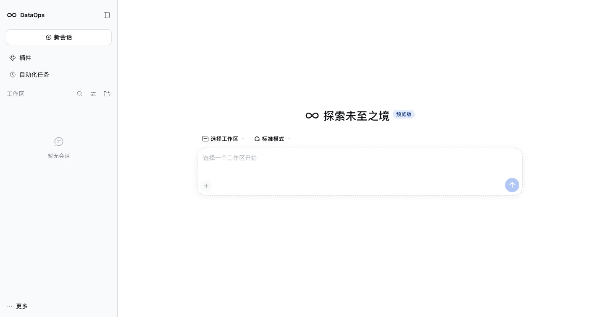

# 换品牌（Rebranding）分析

> 问题：dataops-harness 要不要、怎么换成自己的品牌？
> 结论：**产品标识可以换（官方留了 seat）；视觉主题换起来很重；法律命名必须换。**
> 先澄清一个坑：`@deepseek-ai/dsh-brand` **不是**品牌包，它是 TypeScript 的名义类型（`brandString`/`brandNumber`），跟 Logo、名字无关。

---

## 1. 换品牌到底换什么

| 层面 | 具体项 | 难度 | 官方是否支持 |
|---|---|---|---|
| 产品名 | 侧栏名称、页面标题、关于页 | 低 | ✅ 有 slot + 环境变量 |
| Logo / 图标 | 侧栏 mark、Hero mark、应用图标、favicon | 低 | ✅ 有 slot；桌面要换打包图标 |
| 插件/包展示 | 插件市场卡片、bundle 详情 | 低 | ✅ `icon` + `locale` 元数据 |
| 主题色 / 字体 | `--dsw-*` token、Montserrat | 高 | ❌ 要替换/派生 `ui-theme` |
| 桌面应用身份 | appId、productName、签名、更新通道 | 中 | ✅ electron-builder 配置 |
| 命名与法律 | 项目名、包 scope、声明 | 必须 | ✅ 有品牌指南 |

---

## 2. 官方留了哪些口子（产品标识层）

### 2.1 侧栏品牌

`ui-sidebar` 声明了两个 single / root slot：

| slot | 渲染什么 | 默认（没有 occupant 时） |
|---|---|---|
| `sidebar.brand.mark` | Logo 图形 | 官方鱼标 |
| `sidebar.brand.name` | 产品名 | `DSH Local Build`（locale `brand.localBuild`） |

做法：写一个 `packages/dataops-brand/` 客户端插件，注册这两个 slot；**不要挂 `@deepseek-ai/dsh-client-ui-brand-official`**。如果官方品牌行仍在组合里（built web 资产默认是 official 构建），还要在 profile 里显式禁用它：

```yaml
- id: ui-brand-official
  disabled: true
```

否则两个 single slot 会打架，实测官方品牌会占住位置。

> `ui-brand-official` 用 `DSH_CLIENT_BUILD_PROFILE=official` 门控：official 构建才注册官方 mark/name，其他构建保留 shell 兜底（鱼标 + 本地构建字样）。所以非 official 构建本来就不会显示"DeepSeek Harness"，只是显示 `DSH Local Build`，需要我们用品牌包替掉。

### 2.2 空会话 Hero

`conversation.hero.brand.mark`（single / root）——空会话页中央的动画鱼标。`ui-brand-official` 故意不占它，留的是官方兜底。换品牌时一并注册自己的 mark。

### 2.3 浏览器标题

`apps/web/vite.config.ts`：

```ts
const title = escapeHtmlText(process.env.DSH_CLIENT_TITLE ?? DEFAULT_CLIENT_TITLE) // 'DSH Local Build'
```

构建时设置 `DSH_CLIENT_TITLE=数据开发工作台` 即可改 `<title>`。AppFrame 的产品标题同样读它：

```ts
const productTitle = process.env.DSH_CLIENT_TITLE ?? t('brand.localBuild')
```

侧栏品牌下的版本徽标另由 `DSH_CLIENT_VERSION`（必需）、`DSH_CLIENT_COMMIT_HASH`（可选 7 位）、`DSH_CLIENT_GIT_DIRTY=true` 组成，构建时一并设置。

### 2.4 插件 / Bundle 展示

插件管理器和市场卡片读包元数据（`docs/cookbook/adding-a-package.md#plugin-display-metadata`）：

```
packages/dataops-bundle/
  package.json          # 顶层 "icon": "./icon.svg"
  locale/en.json        # { "meta": { "title": "...", "description": "...", "detail": "docs/DETAIL.md" } }
  locale/zh.json
```

`files` 要包含 `locale/*.json`、`icon.svg`、`docs/`。这样在 Plugins 页、市场卡片、bundle 详情里显示的是我们的名字和图标。

### 2.5 桌面应用（如果做客户端）

`dsh-desktop/dsh-plugin-desktop/package.json` 的 electron-builder 配置：

```json
"appId": "ai.deepseek.dsh.desktop",
"productName": "DSH Desktop",
"build": { "icon": "build/app-icon.icon", ... }
```

换品牌要改：`appId`、`productName`、`build/app-icon*`、托盘图标、`CFBundleLocalizations`、安装器名称、更新通道。**appId 一改就是新应用**：用户数据目录、更新通道、签名都要重新规划。

---

## 3. 视觉主题层（要换得重）

- `ui-theme` 拥有全部 `--dsw-*` token、字体、圆角、阴影、明暗主题；`brand-font.css` 用的是 Montserrat。
- `docs/web-styling.md` 明确：**功能包不得覆盖主题**；主题选择器只属于 theme owner。
- 所以"换主题色/字体"只有两条路：
  1. 派生/替换 `ui-theme` 包（每次上游升级要重放，和打补丁一个性质）；
  2. 加入自己的 theme package 并替换 theme row（同样要跟版本）。
- **建议**：第一版沿用 DSH 的 token 和系统字体，只换 Logo / 名字 / 图标。品牌字标单独使用官方 Montserrat Medium（SIL OFL，随品牌包内联），不改 `ui-theme` 的界面字体。主题色以后有明确需求再动。

### 品牌标记与字标（2026-10-26）

- **标记**：∞ 丝带，loop 粗/crossing 细，viewBox `0 0 24 17.6`，贴近原生鱼标的横向比例；不再用方形 stroke 图标。
- **字标**：`dataops` 独立 SVG lettering，由 Montserrat Medium 轮廓转曲、收紧字距并加 0.35 光学描边；不依赖运行时字体。
- **关系**：和原生 DSH 字标同族但不复刻；原生是定制字形，我们使用官方品牌字体轮廓 + 自定义比例，避免蹭官方资产。
- 资产：`packages/dataops-brand/src/brand.js`（路径）；`assets/montserrat-medium.woff2` 与 `assets/Montserrat-OFL.txt` 作为字形来源与授权留档（不参与运行时）。
- 预览：`prototype/shots/logo-preview.png`、`prototype/shots/real-dataops-brand.png`。

---

## 4. 命名与法律（必须）

`BRAND_GUIDELINES.md` 的硬规则：

1. 项目名**不要**直接用 "DeepSeek Harness" 商标；建议用缩写 **DSH** 或自己的名字。
2. 描述里可以说 "built on DeepSeek Harness" / "compatible with DeepSeek Harness"。
3. 不要用官方品牌素材暗示官方背书、合作或授权。
4. 本项目 README 也照做：加一句"独立项目，与 DeepSeek 无隶属/授权关系"。

包命名：

- 自己的包用自有 scope：`@dataops/dsh-dataops-client`、`@dataops/dsh-dataops-bundle`。
- 依赖继续用 `@deepseek-ai/dsh-*`，**不要改**。
- `dsh` 命令、`DSH_*` 环境变量、`engines.dsh`、`dsh.bundle.patch`、session 存储格式、wire 字段——**一律不动**；改了就是 fork，不再是发行版。

---

## 5. 不该换的清单

| 东西 | 为什么不动 |
|---|---|
| `@deepseek-ai/dsh-*` 包名 | 上游运行时契约；换名 = 重新发布一整族包 |
| `dsh` CLI 命令 | 唯一受支持的应用启动器（`docs/architecture.md#application-launch`） |
| `DSH_*` 环境变量 | 启动器/桌面/运行时共用；改名要改启动器 |
| `engines.dsh` / peer 范围 | 插件兼容性校验依赖它 |
| `dsh.bundle.patch` / `dsh.client` 字段 | Loader 与浏览器启动的协议 |
| session 存储格式 / wire 字段 | 兼容性与审计 |
| `@deepseek-ai/dsh-brand` | 它是 TS 名义类型，不是品牌资产，别误改 |

---

## 6. dataops-harness 的落地清单

| # | 动作 | 产出 | 工作量 |
|---|---|---|---|
| 1 | 新建 `packages/dataops-brand/` 客户端插件，注册 `sidebar.brand.mark` / `sidebar.brand.name` / `conversation.hero.brand.mark` | 侧栏与空会话显示自有 Logo/名称 | 1–2 天 |
| 2 | 构建时设 `DSH_CLIENT_TITLE=数据开发工作台` | 浏览器标题、AppFrame 标题 | 0.5 天 |
| 3 | `packages/dataops-bundle/` 加 `icon`、`locale/en.json`、`locale/zh.json`、`meta.detail` | 插件市场/bundle 卡片显示自有品牌 | 0.5 天 |
| 4 | README/关于页加独立项目声明，按 `BRAND_GUIDELINES.md` 命名 | 合规 | 0.5 天 |
| 5 | 若做桌面：改 `appId`、`productName`、图标、本地化、更新通道 | 独立桌面应用 | 2–3 天 + 签名/发布 |
| 6 | 若要换主题色/字体：派生 `ui-theme` 或新建 theme 包 | 自有视觉 | 1–2 周 + 每次升级维护 |

**建议顺序**：1 → 2 → 3 → 4（一周内完成产品面换牌），主题和桌面按需再做。

---

## 6.5 验证记录（2026-10-25，真机）

用桌面端自带的 DSH 运行时（**0.2.1-rc.2**）在独立 `dataops` profile 上实际启动验证：

```sh
DSH_HOME=<临时 home> node "<DSH Desktop.app>/Contents/Resources/app/node_modules/@deepseek-ai/dsh/lib/bin.js" \
  --profile dataops --no-open --port 3099
```

结果：

- `--dump-config` 能看到 `dataops-brand` / `dataops-client` 两行；`--profile` 组合正常。
- 禁用 `ui-brand-official` 后，侧栏实际显示 **∞ DataOps**，空会话 Hero 显示 **∞ 探索未至之境**（截图：`prototype/shots/real-dataops-shell.png`）。


- 浏览器 console 无错误；`dataops-brand` 与 `dataops-client` 都出现在 `window.__DSH_BOOT__` 的模块图里。
- **踩到的坑 1**：`engines.dsh` 写成 `^0.2.1-rc.3` 时，rc.2 运行时会直接禁用插件（"incompatible"）。已改成 `>=0.2.1-rc.2 <0.3.0`。
- **踩到的坑 2**：官方品牌行不显式禁用时，侧栏仍是 `deepseek HARNESS`；只在 patch 里 insert 自己的品牌包不够。
- **未覆盖**：页面 `<title>` 仍是 `DeepSeek Harness`。它是 built web 资产里烘焙的，`DSH_CLIENT_TITLE` 只在**构建**时生效；运行时改不了。要换标题需自己构建 web 资产。
- `desktop` profile 全程未改动。

---

## 7. 风险

1. **品牌包冲突**：single slot 只能有一个 occupant；官方 `ui-brand-official` 与自有品牌包同时挂载会冲突。做法：自有 profile 不挂官方品牌包。
2. **只改标题不够**：`DSH_CLIENT_TITLE` 只影响文档标题；侧栏名称必须靠品牌包，否则还是 `DSH Local Build`。
3. **桌面 appId 变更**：等于新应用，用户数据、自动更新、签名都要迁移。
4. **主题分叉**：每次上游升级要重放主题差异，和补丁债一样。
5. **商标**：项目名、域名、图标不要蹭官方；描述可以实话实说"基于 DSH"。

---

## 8. 一句话

**产品名/Logo/标题用自有品牌包（官方支持的 slot），主题沿用 DSH；`@deepseek-ai/*`、`dsh`、`DSH_*` 一律不动，法律上按 `BRAND_GUIDELINES.md` 保持独立声明。**
