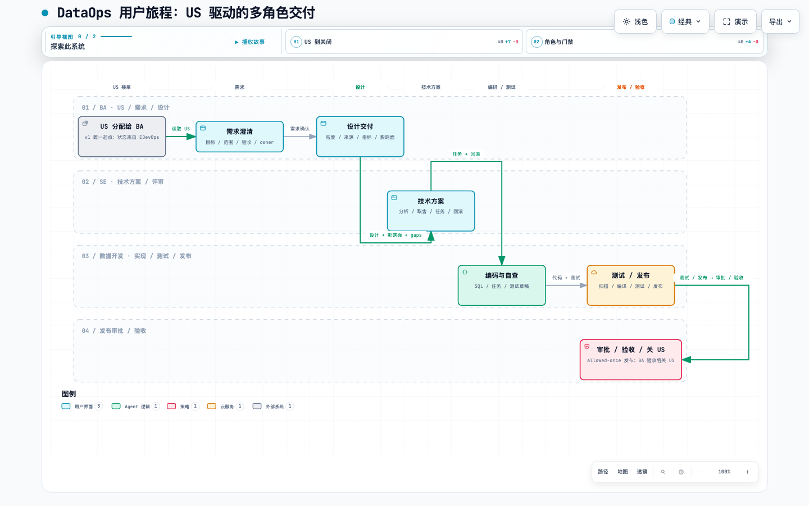

# DataOps 工作台：需求驱动的数据交付设计概要

> 汇报版 v0 · 2026-10-27
> 状态：设计完成度汇报，不作为生产上线承诺
> 详情：[用户旅程设计组](README.md) · [Stage 0+1](stage-0-1-us-intake-requirement.md) · [Stage 2](stage-2-design.md) · [Stage 3](stage-3-scheme.md) · [Stage 4](stage-4-develop.md)

## 30 秒摘要

DataOps 工作台不是“再做一个工具目录”，而是把公司内部的数据需求，从 **US 接单 → 需求 → 设计 → 分析 → 方案 → 技术方案 → 开发验证** 串成一条有负责人、有交付物、有证据、有签收的交付链。

当前已完成从 US 接单到 Stage 5 CICD 制品流水线的详细设计，并用一个贯穿案例（渠道日报支付口径）验证了整条故事线。Stage 6 暂不设计，先做端到端演示和真实平台接入评估。



## 1. 为什么做

现在的问题不是“没有工具”，而是：

- 需求从业务到 BA、SE、数据开发，中间靠人传话，上下文容易丢；
- 数据从哪来、ETL 怎么加工、调度周期怎么定，缺少一条可复核的证据链；
- 每个阶段都有产出，但审批和签收弱，最后只能靠人盯；
- Agent 生成内容很快，但没人敢直接信。

我们想做的是一条**可追溯、可签收、可恢复**的交付链。

## 2. 用户怎么用

| 阶段 | 主角色 | 产出 | 人的门禁 |
|---|---|---|---|
| 0. US 接单 | BA | 工作项、US 摘要 | 接单确认 |
| 1. 需求 | BA | 目标、范围、验收、影响面 | BA + 需求方 |
| 2. 设计 | BA | 目标表、粒度、主键、来源、口径、影响面 | BA 签收，SE 可行性评审 |
| 3a. 分析 | BA | 数据挖掘、探索、基线、候选比较 | BA 签收 |
| 3b. 需求方案 | BA | 方案选择、备选、tradeoff | BA 签收，需求方 advisory |
| 3c. 技术方案 | SE | 任务、依赖、SLA、工时、风险、回滚 | SE 签收，Dev 可落地确认 |
| 4. 开发验证 | Dev | SQL、ETL、调度、API、测试、评审 | SE 评审 + Committer 合入 |
| 5. CICD | Dev / 平台 | 一条数据 pipeline + 制品包 | pipeline 成功；外部发布平台负责环境晋级/审批 |
| 6. 验收/复盘 | BA / 需求方 | 验收、复盘、行动项 | BA / 需求方 |

当前详细设计覆盖到 **Stage 5 CICD 数据制品流水线**；Stage 6 暂不设计。

## 3. 三个核心设计

### 3.1 US 是第一入口，工作项是唯一状态

- v1 只接 EDevOps US，后续再扩 DTS、领导任务、自主探索；
- 选 US → 建/恢复工作项；
- 每个阶段有 stage、substage、deliverables、gaps、approvals、next；
- 关掉会话还能继续，不靠聊天记忆。

### 3.2 DataMap 负责“找数据”，血缘负责“看加工”

DataMap：

```text
场景 → 主题 → 业务对象 → 逻辑实体 → 物理资产
```

用于回答“这类数据在哪、对应哪些表/湖表”，并提供字段说明、owner、行数、assetType。

独立系统负责：

- 血缘：表、ETL、调度、上下游、依赖；
- 运行观测：就绪时间、运行时长、SLA；
- 质量/画像：空值、重复、覆盖、对账；
- 平台扫描：作业规范、并发、任务作业数等。

这套分工避免把 DataMap 当成万能元数据平台。

### 3.3 卡片展示“为什么”，不只是“结果”

- DesignCard：设计结论 + DataMap 寻源 + 设计证据链 + 影响面 + gaps；
- AnalysisCard：数据挖掘/探索/基线/候选比较 + 证据；
- SolutionCard：业务选择、备选、tradeoff；
- TechPlanCard：技术方案摘要 + **设计态血缘**（一层直接上游 + 产出 ETL + 调度 + SLA 余量）；
- DevelopCard：多类型交付物 + build/scan/deploy 验证回流 + SE/Committer 门禁。

复用现有血缘卡，不另造一套血缘体系。

## 4. 角色与 Agent

人类角色：

- BA：需求、设计、分析、需求方案；
- SE：技术方案、代码评审；
- Dev：开发、构建、部署验证；
- Committer / 发布审批：外部系统。

Agent：

```text
Lead / Orchestrator
  ├─ BA Agent
  ├─ SE Agent
  └─ Dev Agent
```

建议“角色 owner + 活动 worker”混合：

- 角色 Agent 对阶段交接和签收负责；
- 数据挖掘、业务方案、技术方案、编码等活动由活动 worker 执行；
- 同一阶段只允许一个写者；
- Agent 负责生成和验证，人类负责确认和签收。

## 5. 关键边界

- **DataMap 不等于血缘/质量平台**；
- **Agent 生成内容不等于事实**：没证据进 gaps；
- **内容签收和发布审批分开**：
  - 内容：需求/设计/分析/方案/技术方案由人签收；
  - 代码：SE 评审 + Committer 合入；
  - 发布：外部准入/线上 CICD，DataOps 不替代；
- **Stage 4 是开发验证，Stage 5 才是可信 CICD**；
- **代码合入、制品发布、生产发布**都不由 DataOps 执行，只产报告和证据；
- **v1 不写 US 状态**：先读，写回后续做。

## 6. 贯穿案例

**US-3821：渠道日报从下单口径改为支付口径**

```text
US 分配到 BA
→ 需求：支付口径、3 个下游、pay_time 缺失
→ 设计：dws.trade_channel_daily / 渠道 × 日期 / dt+channel_id
→ 3a 分析：支付/下单基线、候选来源、join 覆盖
→ 3b 方案：改 dws，下游继承；备选只改 ads
→ 3c 技术方案：ETL + 调度 + 一层上游血缘 + SLA 余量
→ Stage 4：SQL/ETL/schedule/API + build/scan/deploy 回流
→ Stage 5：一条数据 pipeline + 制品包 + 外部环境晋级
```

说明：案例里 3a 发现 blocking gaps 时，流程应停在 3a；后续技术方案是“blockers 关闭后的规划”，不能把历史 mock 当成合法 pass。

## 7. 当前完成度

已完成的详细设计：

- Stage 0+1：USPicker、接单、需求、交付物、Pass；
- Stage 2：设计、DesignCard、DataMap 寻源、设计证据链；
- Stage 3a：分析、AnalysisCard、候选比较、门禁；
- Stage 3b：需求方案、SolutionCard、备选/tradeoff；
- Stage 3c：技术方案、TechPlanCard、设计态血缘、调度推导；
- Stage 4：开发验证循环、SQL/ETL/schedule/API 多产物、SE/Committer 门禁；
- Stage 5：一条数据 CICD pipeline、制品包、外部环境只读状态、CICDCard；
- 用户旅程泳道图、DesignCard/DataMap 视觉稿、TechPlan/Lineage 视觉稿。

尚未完成：

- Stage 6 暂不设计；
- 真实 EDevOps / DataMap / 血缘 / 调度 / 发布接入；
- 跨人签收、US 回写、Agent Team 产品化协同。

## 8. 下一阶段

1. 以 US-3821 做一条完整演示线；
2. 再评估真实平台接入顺序。

## 9. 需要领导确认

1. 方向是否认可：**US 驱动、工作项承载、阶段签收、DataMap/血缘分工**；
2. 角色边界是否认可：BA / SE / Dev / Committer / 发布审批各自负责什么；
3. 是否先做端到端演示，Stage 6 暂不设计；
4. 真实接入时，DataMap、血缘、调度、EDevOps 的接口 owner 需要明确。

## 一句话

**先让一条数据需求在 DSH 内跑通“可解释、可签收、可恢复”的全过程，再谈全量平台接入。**
