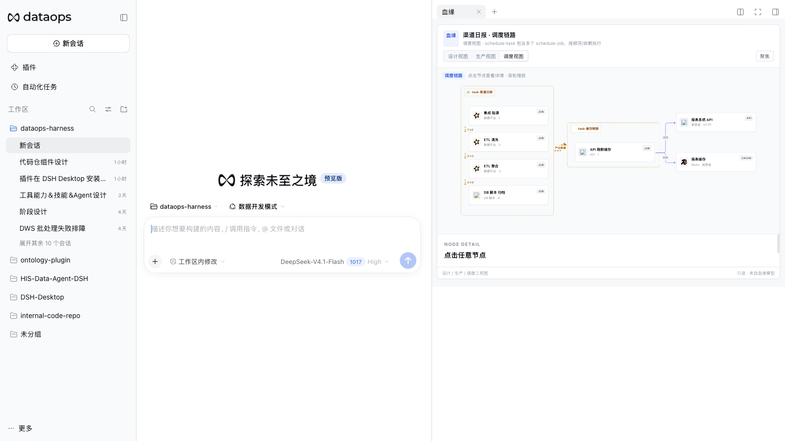
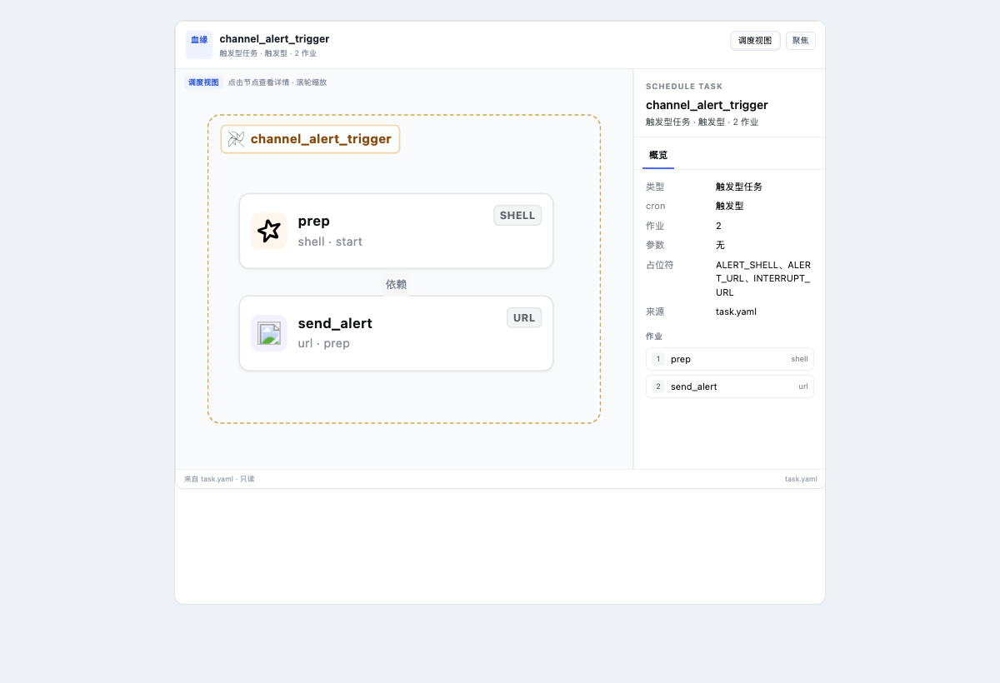
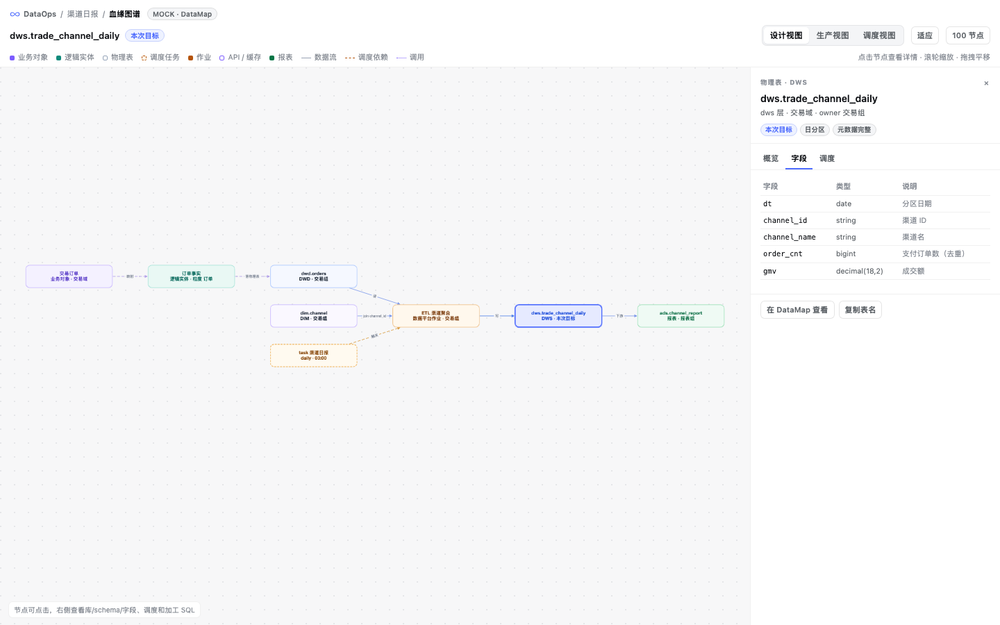
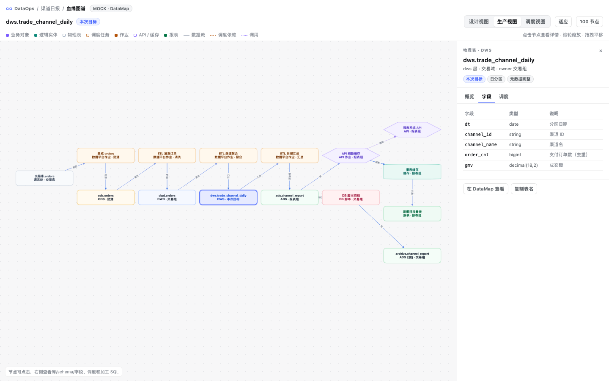
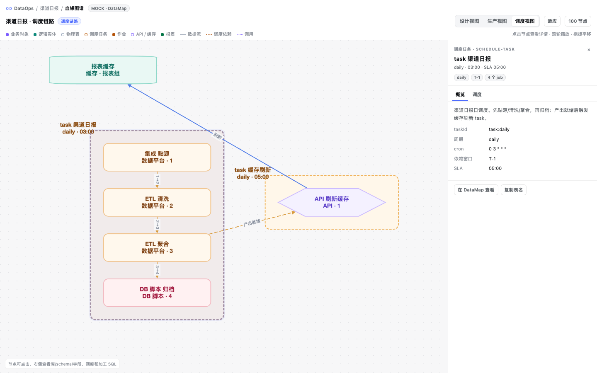
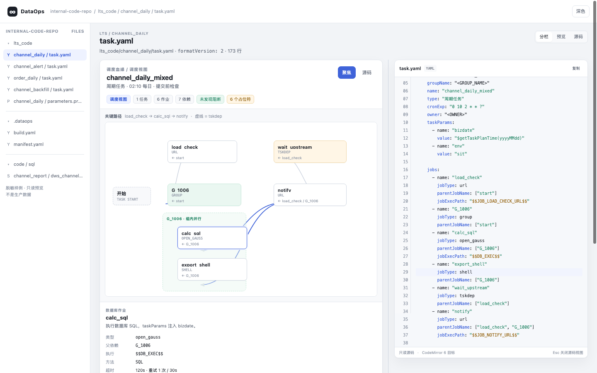
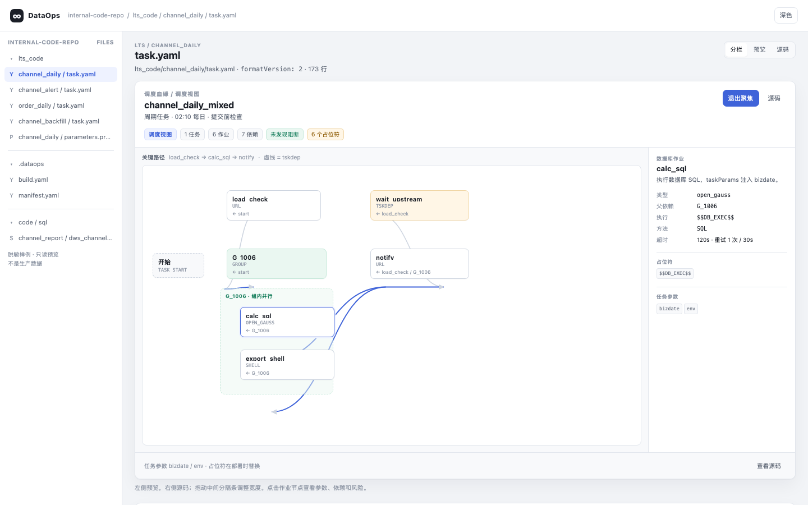

# UI 上下文与设计目标

## 1. 当前入口

### 文件浏览

复用 DSH 工作区 Files tab。DataOps 不再造第二个代码仓页面。

### task.yaml 预览

```text
┌────────────────────────────────────────────────────┐
│ 分栏 / 预览 / 源码                                  │
├──────────────────────────────┬─────────────────────┤
│ LineageSurface               │ CodeMirror           │
│ 左：三视图血缘卡              │ 右：只读源码         │
│                              │                     │
│ 图 + inspector               │ 行号 / 语法高亮      │
└──────────────────────────────┴─────────────────────┘
```

### 右栏“血缘”

同一张 `LineageSurface`：

- 设计视图 / 生产视图 / 调度视图
- compact / focus
- 图 + 节点 inspector
- 不再打开全宽工作台

## 2. 当前真实状态

### 已做到

- `task.yaml` 左侧使用真实解析数据
- `channel_alert` 显示 `channel_alert_trigger`、`prep`、`send_alert`
- 不再使用静态“渠道日报 / 集成贴源”
- 右侧源码是 CodeMirror 5.65 只读
- 卡片有宽度/高度上限，不会 fixed 全屏
- 节点图标、rf-card 样式正常
- 暗色/亮色跟随 DSH

### 还存在的问题

1. 文件预览分栏比例在侧栏宽度下不稳定
2. task group 的图形区域容易产生空白
3. inspector 与作业列表在窄卡里争抢空间
4. 设计/生产/调度三视图和 YAML 调度视图的视觉身份需要统一
5. “参数 / 占位符 / 作业 / 依赖”信息层级不够清楚
6. 文件预览和右栏卡片的尺寸规则还不完全一致

## 3. 截图

### 当前右栏血缘卡



### 当前真实 YAML 卡



说明：此截图来自同一 `LineageSurface` 组件，使用 `channel_alert` 的真实解析数据；不是静态 mock。

### 旧三视图内容

设计视图：



生产视图：



调度视图：



### 早期分栏原型





原型可打开：`prototype/schedule-lineage-redesign.html`

## 4. 组件边界建议

```text
LineageSurface
├─ Header
│  ├─ task / table / title
│  ├─ view tabs: design / production / schedule
│  └─ compact / focus
├─ Graph
│  ├─ task group
│  ├─ job nodes
│  ├─ semantic edges
│  └─ selected node
├─ Inspector
│  ├─ overview
│  ├─ params
│  ├─ jobs / dependencies
│  └─ source entry
└─ Footer
```

文件预览的 `task.yaml` 变体：

- 只有调度视图是真实数据
- 不伪造设计视图、生产视图
- 源码在右侧独立分栏
- inspector 表达当前 task / job

## 5. 设计要求

### 视觉

- 使用 DSH token，不另造颜色系统
- 高密度工程界面，但避免 8px 字号堆叠
- 语义色：url 蓝、group 绿、tskdep 橙、数据库青/绿、shell 中性
- 卡片有统一圆角和边界
- 不把图标作为装饰大图

### 交互

- 点节点更新 inspector，不重排整张图
- 点 task group 显示任务级信息
- 切 tab 保留选中节点；不可用的视图不显示
- focus 只在当前容器内放大
- 源码分栏和预览卡保持同一高度基线
- 窄容器自动改为上下布局

### 响应式

至少覆盖：

```text
1024 / 1280 / 1440 / 1600
```

右侧栏场景优先，不要假设总是全宽页面。

## 6. 设计评审标准

- 用户能否在 5 秒内说出：任务名、cron、作业数、关键依赖
- 用户能否从 YAML 文件看出它对应哪张调度图
- inspector 是否被截断
- 是否出现“图只有 2 个节点却占满一屏”的失衡
- 源码和预览分栏是否像一个整体
- 是否还残留第二套全宽工作台的感觉
